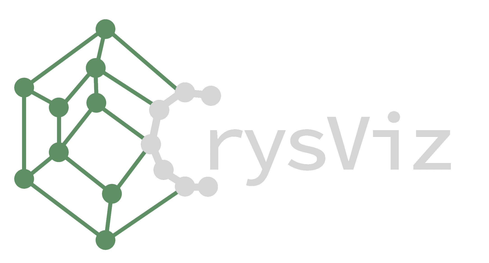
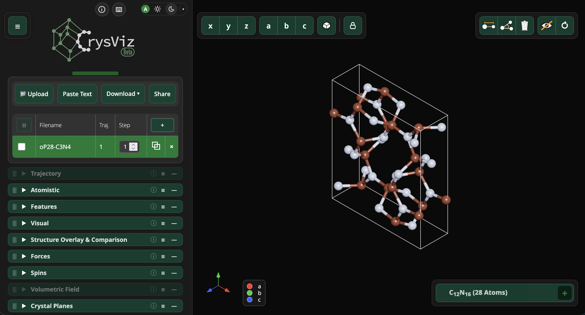

# CrysViz - Crystal Structure Visualisation & Analysis

## Light-weight browser-based crystal structure visualisation and analysis with on-device rendering.

Run it in your browser at [crysviz.org](https://crysviz.org).




CrysViz is a standalone visualisation and analysis tool built on top of Three.js. Paste a POSCAR/CIF snippet, drop a local file, or paste an OPTIMADE structure URL or an Alexandria ID. Everything runs on your device: your crystal structures do NOT leave it.

Copyright (C) 2025-2026 Florian Trybel, Abhijith S Parackal, Oscar Bulancea-Lindvall, Henricus R.A. ten Eikelder and Rickard Armiento


## Key Features

No backend is needed. CrysViz runs entirely in the browser, on desktops, tablets and phones.

**Files**
- VASP (POSCAR/CONTCAR, OUTCAR, CHGCAR, ELFCAR, WAVECAR; INCAR `MAGMOM` as spins), Quantum ESPRESSO input and output, CIF and mCIF (with symmetry and standard uncertainties), XYZ and extended XYZ, ASE `.traj`, Gaussian cube, CASTEP `.cell`/`.geom`/`.md`/`.ts`, SHELX/AIRSS `.res`, FHI-aims `geometry.in`/`aims.out`, and phonopy files. File types are recognised from their contents.
- Export to CIF (P1 or symmetrised), POSCAR, CASTEP `.cell`, FHI-aims `geometry.in` and Quantum ESPRESSO cards, and save images (raster or ray-traced).

**Viewing and rendering**
- Raster rendering with good transparency, plus a ray tracer and a path tracer for figures.
- Coordination polyhedra, including cages (B12, clathrates, C60), with per-polyhedron and per-category colours.
- Crystal (hkl) planes: cut through the structure, look along a plane normal, show a field on a plane.
- Volumetric fields: isosurfaces of charge densities, ELF and wavefunctions (CHGCAR, ELFCAR, cube, WAVECAR), loaded in the background.
- Force and spin arrows, also during trajectories.
- Focus regions to make one atom, molecule or defect stand out; molecules and rings that cross the cell boundary drawn whole.
- Your own colours for any atom, element colours, radii and bond lengths; settings are remembered per structure.

**Building and editing**
- Add, remove and modify atoms and the lattice, also in symmetry-constrained (Wyckoff) mode.
- Supercells, lattice transformations and vacuum layers.
- Ordered approximants of structures with disordered sites.

**Analysis**
- Distances and angles; the Selection Inspector shows the selected atoms with every bond length and angle, and compares them with a second structure.
- Bond-length, force and coordination histograms.
- Symmetry (powered by Moyo WASM): space group, Wyckoff sites, the asymmetric unit, standardised primitive and conventional cells.
- Lattice analysis, lattice parameters across a trajectory, structure overlay and comparison, energy landscapes and equation-of-state fits.

**Simulations on your device**
- Relaxations and molecular dynamics (NVT and NPT, with optional annealing) with machine-learned potentials running in the browser: NEP (NEP89 by default) and PET-MAD.
- Energies, forces and stress; equation-of-state scans.
- Optionally an ASE server backend, for any ASE calculator (e.g. MACE, VASP, Quantum ESPRESSO).
- Phonons from phonopy: band structure and DOS, and the modes animated on the atoms.

**Trajectories, sharing and more**
- Trajectory player with plots, for relaxations and MD from OUTCAR, Quantum ESPRESSO, CASTEP, FHI-aims, ASE and XYZ; large trajectories are read frame by frame.
- Share links and QR codes, and `.crysviz` session files.
- Search everything (Ctrl/⌘+F) finds any window, button or setting.
- Install as an app (Chrome or Edge on desktop) and open structure files from the file manager.
- Widget mode to embed a viewer in another web page (see below).
- A Python API and an MCP server for Claude and other AI assistants (see below).


This project is licensed under the GNU Affero General Public License v3.0 (AGPL-3.0).
This program is free software: you can redistribute it and/or modify it under the terms of the GNU Affero General Public License as published by the Free Software Foundation, either version 3 of the License, or (at your option) any later version. This program is distributed in the hope that it will be useful, but WITHOUT ANY WARRANTY; without even the implied warranty of MERCHANTABILITY or FITNESS FOR A PARTICULAR PURPOSE. See the GNU Affero General Public License for more details. You should have received a copy of the GNU Affero General Public License along with this program. If not, see https://www.gnu.org/licenses/.


## Maintainer
- **[Florian Trybel](https://github.com/ftrybel)** - Project lead
- **[Abhijith S Parackal](https://github.com/Abhivega)**
- **[Rickard Armiento](https://github.com/rartino)**
- **[Oscar Bulancea-Lindvall](https://github.com/oscarlindbul)**
- **[Henricus R.A. ten Eikelder](https://github.com/RicktenE)**


## Installation and use

### In your browser

Open [crysviz.org](https://crysviz.org). Nothing to install.

### Locally, in your browser

To run CrysViz without the Internet, serve it from your own computer:

```bash
git clone https://github.com/CrysViz/crysviz.git
cd crysviz
make serve
```

Then open the URL shown.

### Stand-alone application

The `crysviz` Python package opens CrysViz in its own window (pywebview). It
needs a native GUI backend, which the `qt` or `gtk` extra installs:

```bash
pip install 'crysviz[qt]'        # or 'crysviz[gtk]'
crysviz structure.cif            # open files in a window
crysviz --browser structure.cif  # or in your system browser, no GUI backend needed
```

On Linux you can reuse the system's Qt instead of downloading it. Create the
venv with access to the system packages, for example with uv:

```bash
uv venv --system-site-packages .venv
uv pip install --python .venv/bin/python crysviz
.venv/bin/crysviz
```

If the window does not open, check that pywebview works on its own (see
[examples/README.md](examples/README.md) and the
[pywebview installation guide](https://pywebview.flowrl.com/guide/installation.html)).

The Python API and the MCP server below are newer than the latest release.
Until the next release, install them from a checkout:

```bash
git clone https://github.com/CrysViz/crysviz.git && cd crysviz
pip install -e '.[qt,mcp]'       # or with uv: uv pip install --python .venv/bin/python -e '.[mcp]'
```


## Python API

Drive a CrysViz window from a Python REPL, IPython or Jupyter. Every command is
a method, and the window stays yours: rotate, select and edit by hand between
commands, and Python is told what you changed.

```python
>>> from crysviz import show
>>> v = show(["SrTiO3.cif"])               # the window opens; the prompt returns at once
>>> v.set_supercell(n=[2, 2, 2])
>>> octahedra = v.find(what="polyhedra", where={"cn": 6})
>>> v.apply(selection=octahedra["selection"], action="color", color="#3366ff")
>>> v.set_view(direction="c")              # look along c
>>> v.save_image("view.png")               # shown inline in Jupyter
>>> v.run_relax(fmax=0.02)                 # waits until the relaxation ends
```

`dir(v)` lists every command and `help(v.find)` shows its arguments.

Working together with the window:

```python
>>> v.on("user_changed", print)            # your edits in the window, as you make them
>>> v.take_user_changes()                  # or collect them when you want them
```

In a script, end with `v.wait()` to keep the window open until you close it; a
REPL or notebook keeps it open anyway. The full guide, with calculations,
exports and recipes, is [agent_guides/Python.md](agent_guides/Python.md).
Runnable scripts are in [examples](examples/).


## Claude and other AI assistants (MCP)

`crysviz-mcp` is a local MCP server. It lets Claude, or another MCP client,
work in a CrysViz window on your computer together with you: load and edit
structures, find atoms, bonds, polyhedra and voids, set the view, run MD,
relaxations and EOS scans, read symmetry, phonons and fields, export files and
get pictures back.

Install it (from a checkout until the next release, see above), then add it to
your client.

Claude Code:

```bash
claude mcp add crysviz -- crysviz-mcp
```

Claude Desktop (config file `claude_desktop_config.json`):

```json
{
  "mcpServers": {
    "crysviz": { "command": "/path/to/venv/bin/crysviz-mcp", "args": ["--gui", "qt"] }
  }
}
```

The window opens on the first request. Then ask, for example:

- "Load ~/NaCl.cif and show me the view along c."
- "Make a 3x3x3 supercell, remove one O, relax it and tell me how far the neighbours moved."
- "Find all TiO6 octahedra and colour them blue."
- "Run 2 ps of MD at 600 K and export the trajectory."

The window is shared. Claude leaves your camera, zoom and display settings
alone unless you ask, and it is told about the changes you make by hand. Only
local clients are supported for now (Claude Code, Claude Desktop); claude.ai in
the browser is not supported yet. The tools and options are in
[agent_guides/MCP.md](agent_guides/MCP.md), and [examples/mcp_quickstart.md](examples/mcp_quickstart.md)
walks through a first session.

## Widget mode / embedding

CrysViz can be embedded in another site as a compact interactive viewer with
`?widget=1`. The full guide, with the integration steps, the complete message
protocol and the rules for changing widget code, is
[`agent_guides/Widget.md`](agent_guides/Widget.md); a working host page is
[`docs/widget-embed-demo.html`](docs/widget-embed-demo.html).

Widget mode shows only the 3D structure view (with spin arrows), a locked
composition legend (lower right), a small axes gizmo (lower left) and a camera
control (top right: view along a, b or c, and reset). The CrysViz logo (top
left) is the menu:

- **Open in CrysViz**: the same structure in the full UI, in a new tab
- **Structures**: As loaded / Conventional / Primitive
- **Shading**: Metallic / Matte / Cel shading (plus Ray tracing / Path tracing
  with `tracers=1`)
- **Bonds** and **Polyhedra** toggles
- **Download POSCAR / CIF** of the cell shown
- any links the embedder adds (`menuLinks`, below)

**URL contract** — the embedder points an `<iframe>` at:

```
https://crysviz.org/index.html?widget=1[&control=1][&tracers=1][&theme=dark|light][&prefs=1]#<route>
```

| Query | Effect |
|---|---|
| `widget=1` | widget mode (required) |
| `control=1` | let the host page drive the widget over `postMessage` (below) |
| `tracers=1` | offer ray and path tracing (downloads the tracer pipelines; skipped by default) |
| `theme=dark` / `light` | force the UI theme at boot instead of following the OS; not persisted |
| `prefs=1` | re-apply the per-structure customisations (per-atom colours, focus regions) this browser saved in the full app. Off by default: the embed has no UI to see or reset them |

The fragment says where the structure comes from:

| Route | Use |
|---|---|
| `#load-file=<name>\|<base64>` | the file in the URL: name and base64 of its UTF-8 text, each URL-encoded. Simplest, for small text files; browsers cap URL length |
| `#load-url=<url>[\|<name>]` | fetched from an http(s) URL without cookies; the server must send `Access-Control-Allow-Origin` |
| `#load-message` | posted by the embedding page: no size limit, binary allowed. The widget posts `{source:'crysviz-widget', type:'awaitingSession'}` to its parent, which answers `{target:'crysviz-widget', type:'loadSession', name, data}` (`data`: string, ArrayBuffer, typed array or Blob) |

The file can be any format CrysViz reads, or a frames-style `.crysviz` session
(the "CrysViz" download format; `"format": "crysviz"` is required). The minimal
session is a single frame with `spins` and the display toggle on:

```json
{
  "format": "crysviz",
  "version": "2.16",
  "frames": [{
    "elements": ["Fe", "Fe", "O", "O"],
    "lattice": [[a,0,0],[0,a,0],[0,0,c]],
    "positions": [[0,0,0], ...],
    "spins": [{ "vector": [0,0,2] }, ...]
  }],
  "selectedFrameIndex": 0,
  "display": { "spinsActive": true }
}
```

Spin vectors are Cartesian magnetic moments, index-aligned to `positions`. The
Conventional/Primitive options symmetrise the cell (via moyo) on first pick
and remap the moments onto the new cell; a magnetic order that the smaller cell
cannot carry (a magnetic supercell) greys that option out. "Open in CrysViz"
opens the launch data in the full UI, on the frame shown when it is a
`.crysviz` session (a moyo-built cell, or any other file, opens as loaded): by
URL for a `#load-file=` launch that fits, otherwise by handing the data to the
new tab over `postMessage`.

**Precomputed cells (`frameKinds`)** — a database that already knows the
conventional and primitive cells can ship them as extra frames instead of
paying for the in-browser symmetrisation. Send a multi-frame session whose
`frames` are `[as-loaded, conventional?, primitive?]` and add a top-level
`frameKinds` array, order-aligned with `frames`, labelling each with
`"loaded"`, `"conventional"`, or `"primitive"` (kinds after the first are
optional):

```json
{
  "format": "crysviz",
  "version": "2.16",
  "frames": [ { …loaded… }, { …conventional… }, { …primitive… } ],
  "frameKinds": ["loaded", "conventional", "primitive"],
  "selectedFrameIndex": 0,
  "display": { "spinsActive": true }
}
```

When `frameKinds` is present the widget's Structures menu lists **exactly the
shipped frames**, one entry per kind (`"loaded"` reads "As loaded", other
strings are capitalised), and picking one selects that frame — no moyo runs
and no in-browser spin remapping happens. `frameKinds` must be an array of
strings with one entry per frame; otherwise it is dropped and the menu falls
back to the moyo build path above. The key is widget-only: the full app
ignores `frameKinds` entirely (a session with it loads as an ordinary
multi-frame trajectory).

**Menu links (`menuLinks`)** — the embedder can add its own dropdown items that
open URLs. A top-level `menuLinks` array of `{label, url}` (same channel as
`frameKinds`) renders as plain items in the widget menu after the Download
items; clicking one opens `url` in a new tab. The altermagnets DB uses this
for links to its files endpoint. Validated strictly: each `label` a non-empty
string (≤40 chars), each `url` an `http`/`https` URL that parses; invalid
entries are dropped, an empty result shows no group. Widget-only — the full
app ignores it.

```json
{ "menuLinks": [
  { "label": "Database entry", "url": "https://altermagnets.example/entry/x" },
  { "label": "Download VASP inputs", "url": "https://altermagnets.example/files/x.zip" }
] }
```

**Host control (`control=1`)** — the host page can step a trajectory, switch
between several structures loaded as frames, and link the cameras of two
widgets. Commands go to the iframe as
`{target:'crysviz-widget', type, …}`: `getState`, `setFrame {index, recenter?}`,
`fitView`, `play {fps?, loop?}`, `pause`, `getCamera`, `setCamera {view}`. The
widget answers with `{source:'crysviz-widget', type, …}`: `ready`, `state`,
`frame`, and `camera` (the user moved the camera; moves made by host commands
are never reported, so two linked widgets do not echo). Only the iframe's
direct parent can drive it. See [`agent_guides/Widget.md`](agent_guides/Widget.md)
for the fields and examples.

**Sandboxing** — the iframe does **not** need `allow-same-origin`; give it
`sandbox="allow-scripts allow-popups allow-popups-to-escape-sandbox allow-downloads"`
(popups for "Open in CrysViz" and menu links, downloads for POSCAR/CIF). Widget
mode runs correctly in an opaque origin where browser storage and web workers
are unavailable (preferences fall back to defaults, heavy work runs on the
main thread). An opaque-origin embed does, however, require the CrysViz host to
serve CORS headers (`Access-Control-Allow-Origin`) for its ES-module and WASM
fetches — true on GitHub Pages (where crysviz.org is served) and in
`make serve`, and something self-hosters must configure.

## Third-Party Libraries

1. THREE.js
   - Repository: https://github.com/mrdoob/three.js/
   - License: MIT
   - Copyright: THREE.js authors
   - See docs/external/three/LICENSE for the full license text.
   - License and code can be found in docs/external/three/
   
2. Moyo
   - Repository: https://github.com/spglib/moyo
   - License: MIT or Apache-2.0
   - Copyright: Kohei Shinohara
   - See docs/external/moyo-test/LICENSE for the full license text.
   - Explicitly moyo-wasm is used.
   - License and code can be found in docs/external/moyo-test/

3. NEP_CPU
   - Repository: https://github.com/brucefan1983/NEP_CPU
   - License: GPL-3.0
   - Copyright: NEP_CPU authors
   - See docs/external/nep_wasm/LICENSE-NEP_CPU for the full license text.
   - Explicitly NEP_CPU is compliled into a WASM module. 
   - License and code can be found in docs/external/nep_wasm/

4. NEP89 Weights (from GPUMD)
   - Repository: https://github.com/brucefan1983/GPUMD
   - License: GPL-3.0
   - Copyright: GPUMD authors
   - The weights can be found in docs/external/nep_wasm/
   - See docs/external/nep_wasm/LICENSE-GPUMD for the full license text.

5. three-wboit
   - Repository: https://github.com/stevinz/three-wboit
   - License: MIT
   - Copyright: Stephens Nunnally (@stevinz); portions mrdoob and three.js authors, Alexander Rose
   - See docs/external/three-wboit/LICENSE for the full license text.
   - Used by the optional "Weighted blended (WBOIT)" rendering pipeline.
   - License and code can be found in docs/external/three-wboit/

6. three-depthpeeling-demo
   - Repository: https://github.com/gkjohnson/three-depthpeeling-demo
   - License: MIT
   - Copyright: Garrett Johnson
   - See docs/external/three-depthpeeling/LICENSE for the full license text.
   - Adapted (not verbatim) for the optional "Depth peeling" rendering pipeline;
     see docs/external/three-depthpeeling/README.md for the divergences.
   - License and code can be found in docs/external/three-depthpeeling/

7. THREE.js-RayTracing-Renderer
   - Repository: https://github.com/erichlof/THREE.js-RayTracing-Renderer
   - License: CC0 1.0 (public domain; attribution given as a courtesy)
  The CC0 dedication applies to the upstream original only; CrysViz's
     local adaptations in docs/external/three-raytracing/ and the first-party ray/path
     tracing code under docs/render/pipeline/ are licensed AGPL-3.0.
   - Author: Erich Loftis (@erichlof)
   - See docs/external/three-raytracing/LICENSE for the full license text.
   - GLSL chunk library adapted for the optional "Ray tracing" rendering
     pipeline; see docs/external/three-raytracing/README.md for the adaptations.
   - License and code can be found in docs/external/three-raytracing/

8. THREE.js-PathTracing-Renderer
   - Repository: https://github.com/erichlof/THREE.js-PathTracing-Renderer
   - License: CC0 1.0 (public domain; attribution given as a courtesy)
  The CC0 dedication applies to the upstream original only; CrysViz's
     local adaptations in docs/external/three-pathtracing/ and the first-party ray/path
     tracing code under docs/render/pipeline/ are licensed AGPL-3.0.
   - Author: Erich Loftis (@erichlof)
   - See docs/external/three-pathtracing/LICENSE for the full license text.
   - GLSL chunk library adapted for the optional "Path tracing" rendering
     pipeline; see docs/external/three-pathtracing/README.md for the adaptations.
   - License and code can be found in docs/external/three-pathtracing/

9. QR Code generator
   - Repository: https://github.com/nayuki/QR-Code-generator
   - License: MIT
   - Copyright: Project Nayuki
   - Loaded on demand from jsDelivr (npm `nayuki-qr-code-generator`) to draw the
     QR code in the share-link dialog.

10. httk data-generators
   - Repository: https://github.com/httk/data-generator
   - License: CC-BY-4.0 (https://creativecommons.org/licenses/by/4.0/)
   - Copyright: Rickard Armiento
   - Generated with cctbx (https://cctbx.github.io/) and spglib
     (https://spglib.readthedocs.io/).
   - Space-group settings, symmetry operations, Wyckoff positions and
     asymmetric units. The dataset carries its own license and provenance
     metadata; both live in docs/data/symmetry_basics.json.

## Other Attributions

- CrysViz uses some color maps from the [Scientific colour maps by Fabio Crameri](https://doi.org/10.5281/zenodo.1243862) (Version 8)
- [OPTIMADE](https://www.optimade.org/) compatible structure providers including Materials Project and Alexandria.
