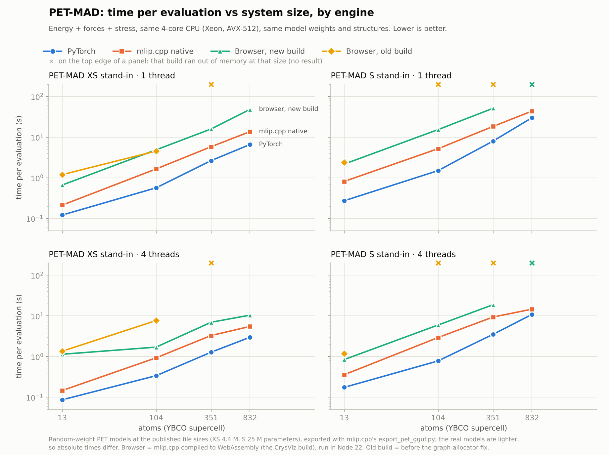

# PET-MAD by engine: PyTorch, mlip.cpp native, browser (2026-10-25)

The PyTorch timings use metatomic's ASE calculator, which upet's
`UPETCalculator` wraps. They run on the CPU, with conservative forces (energy
gradient), as the calculator does by default. On a machine with CUDA or an
Apple GPU, the calculator picks the GPU automatically. Every run evaluates
energy, forces and stress.

The models are random-weight PET models exported with mlip.cpp's own
`export_pet_gguf.py` (`tools/bench/make_random_pet_graph_gguf.py`). They have
the published file sizes but are heavier than the real models:

| stand-in | parameters | file |
|---|---:|---:|
| XS | 4.4 M | 16.8 MB |
| S | 25 M | 95.3 MB |

For example, the real XS takes ~90 ms for 13 atoms in the browser, against
665 ms for the stand-in. Absolute times therefore don't carry over to the real
models; the ratios between engines do.

All three engines give the same energies, forces and stress for the same
input, to float32 precision.

Data: `engines.csv`. Plot: `python3 tools/bench/plot_petmad_engines.py engines.csv`.

## Where mlip.cpp spends its time

Measured with callgrind on the native build, XS stand-in, 104 atoms, 1 thread.
Computing the graph takes 99.7% of the time; building it, under 0.3%.

| part | share |
|---|---:|
| matrix products | 75% |
| — of which row-by-row dot products (`ggml_vec_dot_f32`) | 58% |
| copies and transposes (`cont` / `dup` / `memcpy`) | 16% |
| everything else | ~9% |

The native build uses AVX2 with FMA. ggml's blocked GEMM (`GGML_LLAMAFILE`) is
off, and it has no WebAssembly version. PyTorch uses AVX-512 GEMM kernels. The
browser build is limited to 128-bit WebAssembly SIMD.

## Ratios between engines, 1 thread

| comparison | range |
|---|---|
| mlip.cpp native vs PyTorch | 1.8–3.5× slower |
| browser vs mlip.cpp native | 2.7–3.5× slower |
| browser vs PyTorch | 5–10× slower |
